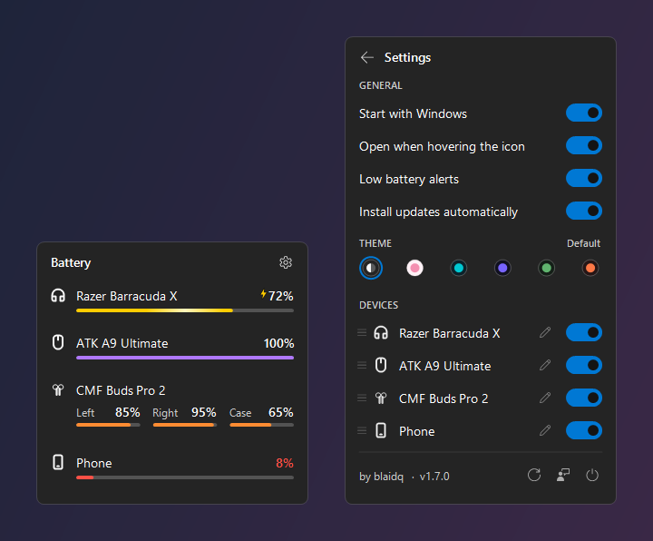
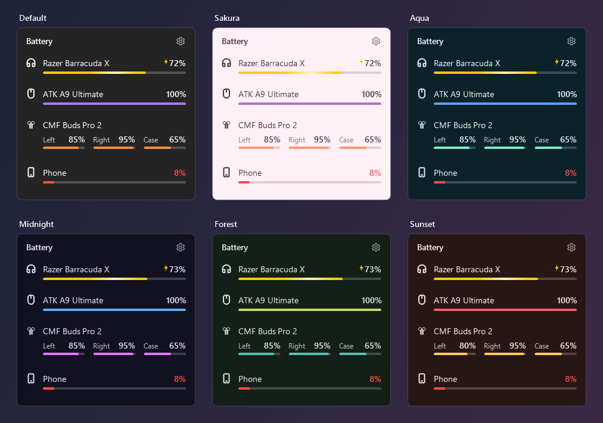

# BatteryRings

Shows the battery levels of your wireless devices in the Windows taskbar as **one icon of concentric rings**.
Hover over (or click) the icon to see every device in detail.





## Supported devices

**Automatically, no setup needed:**
- **Any Bluetooth device that reports its battery to Windows**: headphones, mice, keyboards, controllers.
  If Windows Settings > Bluetooth shows a percentage for it, BatteryRings shows it too.
- **Xbox / XInput compatible wireless controllers** (Windows only reports four steps: Empty / Low / Medium / Full).
- **Wireless keyboards and mice that report battery the standard HID way** (common on 2.4 GHz keyboards), which Windows itself does not display.

**Brand protocols:**

| Brand | Devices | Tested |
|---|---|---|
| Razer | Barracuda X (2022) headset on its 2.4 GHz dongle, with charging state | ✅ |
| Razer | Wireless mice and keyboards (dongle or cable) | – |
| ATK / Compx | ATK A9 Ultimate: a steady percentage computed from the battery voltage (curve measured on this model). Other ATK models and other mice on Compx 2.4 GHz dongles (VID 373B) show the percentage the mouse reports. The dongle does not tell the mouse's name, so it is learned the first time the mouse is plugged in by cable | ✅ |
| Nothing / CMF | CMF Buds Pro 2: left, right and case separately | ✅ |
| Nothing / CMF | Nothing Ear (1) / (2) / (a) / (3) / (open) / (stick), other CMF Buds, Nothing and CMF headphones (same protocol) | – |
| Apple | AirPods, AirPods Pro, AirPods Max and Beats: left, right and case in 10% steps, read from the Bluetooth LE broadcast while they are connected to this PC | – |
| Samsung | Galaxy Buds, Buds+, Live, Pro, Buds2 / 2 Pro, Buds FE, Buds3 / 3 Pro: left, right and case | – |
| Sony | DualSense, DualSense Edge and DualShock 4 controllers, by cable or Bluetooth | – |
| Logitech | Mice, keyboards and G headsets on Unifying, Bolt or Lightspeed receivers, by cable or Bluetooth (HID++ 2.0) | – |
| SteelSeries | Arctis 1 / 7 / 7+ / 9, Arctis Nova 3P / 5 / 7 / Pro Wireless | – |
| HyperX | Cloud Alpha Wireless, Cloud Flight | – |
| Corsair | Void family wireless headsets | – |
| ASUS | ROG / TUF wireless mice: Keris, Gladius II / III, Chakram, Harpe Ace, Pugio II, Spatha X, Strix Carry / Impact, TUF M4, MD200 / MD301 | – |

Untested rows follow public protocol notes (see *Thanks*). If you own one, please open an issue saying whether it works.

- The icon shows the first three devices as rings; the panel lists all of them.
- Devices that are not connected are not shown. With a single device, its icon sits in the middle of the ring;
  with none, the icon is an empty ring and the panel says "No devices found".
- While charging, the ring turns yellow with a moving light; below 15% it turns red and pulses.
- Optional alerts at 20%, 10% and 5%.

## Settings

Click the gear in the panel:

- Start with Windows
- Open the panel when hovering the icon (otherwise click it)
- Theme: Default (follows Windows), Sakura, Aqua, Midnight, Forest, Sunset
- Device order: drag a device up or down; the top one is the outer ring
- Rename a device or change its icon (pencil)
- Footer buttons: check for updates, report a problem, quit
- Low battery alerts
- Install updates automatically, and a **Check for updates** button
- Show or hide each device
- Quit

## Install

1. Download `BatteryRings.exe` from the [Releases](../../releases) page.
2. Run it and answer **Yes** to "Install BatteryRings on this PC?".

It installs itself to `%LOCALAPPDATA%\Programs\BatteryRings`, starts with Windows and adds a Start menu shortcut.
No administrator rights are needed. Running a newer version installs it over the old one.
To uninstall, use Windows Settings > Apps > Installed apps > BatteryRings.

### Updates

An installed copy checks this repository's latest release shortly after start and then every 6 hours.
If there is a newer version it downloads `BatteryRings.exe`, checks it against the published `BatteryRings.exe.sha256`
and its version information, and installs it over the old one. Turn this off in Settings, or use **Check for updates**.

Publishing a release: attach both `dist\BatteryRings.exe` and `BatteryRings.exe.sha256`
(`certutil -hashfile dist\BatteryRings.exe SHA256`, first line of the hash only, lowercase).

> The exe is not code-signed, so Windows SmartScreen or an antivirus may warn about it.
> The full source is here and you can build it yourself.

## Build

Nothing to install: the .NET Framework 4 compiler and the Windows Runtime metadata that ship with Windows 10 / 11 are enough.

```bat
build.cmd
```

Output: `dist\BatteryRings.exe`. Command line options:

| Option | What it does |
|---|---|
| `/portable` | Run without installing |
| `/install`, `/uninstall` | Silent install / uninstall |
| `/test` | Read all devices once and write the result to `test_result.txt` |
| `/report` | Write the device report (see below) to `device_report.txt` |

## Reporting a problem

If a device does not show up or shows wrong values, open Settings (gear) and click the speech-bubble button
(*Report a problem*). Describe the problem; BatteryRings attaches a device report and opens a new issue here
on GitHub, which you can read and edit before submitting (a free GitHub account is needed). Issues are public.
The device report lists only vendor/product ids, interface details and product names: no serial numbers,
user names or file paths.

## How it works

| Device | How |
|---|---|
| Razer Barracuda X | HID interface of the dongle (1532:0552, usage page 0xFF00): battery and charging-cable queries |
| ATK mouse | Compx HID reports (VID 373B, usage page 0xFF02). The firmware percentage jumps around, so the percentage is computed from **voltage** (LiHV curve, full ≈ 4.35 V) and filtered; while charging it rises at the measured charge rate |
| CMF Buds | Nothing protocol over Bluetooth RFCOMM (service `aeac4a03-dff5-498f-843a-34487cf133eb`, battery command `0xC007`) |
| Bluetooth (generic) | Windows device property `{104EA319-6EE2-4701-BD47-8DDBF425BBE5} 2` (SetupAPI) |
| Controllers | `XInputGetBatteryInformation`; PlayStation: battery nibble of the input report |
| AirPods / Beats | Apple "proximity pairing" Bluetooth LE advertisement (company `0x004C`, type `0x07`), strongest signal while an AirPods/Beats device is connected |
| Galaxy Buds | Bluetooth RFCOMM status messages `0x60` / `0x61` pushed by the buds |
| Logitech | HID++ 2.0 features `0x1004` Unified Battery, `0x1000` Battery Status, `0x1001` Battery Voltage, `0x1F20` ADC (headsets) |
| Razer mice / keyboards | 90-byte feature report, power class `0x07`: `0x80` level, `0x84` charging |
| SteelSeries / HyperX / Corsair | Vendor HID commands per model family |
| Standard HID | Usages Battery Strength (`0x06:0x20`) and State of Charge (`0x85:0x64-0x66`) |

Code: `src/Devices.cs` (HID devices), `src/Buds.cs` (Bluetooth earbuds), `src/Generic.cs` (generic Bluetooth and XInput),
`src/Vendors.cs` (Logitech, Razer, ASUS, PlayStation, headsets, standard HID battery), `src/Apple.cs` (AirPods),
`src/GalaxyBuds.cs` (Samsung),
`src/UI.cs` (icon, panel and settings), `src/Program.cs` (install).
To add a device with dedicated support, define a `Slot` in `UI.cs` and read it in `Refresh`.

## Privacy and security

- **The only network traffic is the update check**: a request to `api.github.com` for this repository's latest release and, when there is a new version, the download from `github.com`. Nothing about you or your devices is sent, and automatic updates can be turned off in Settings. Everything else is local USB/HID and Bluetooth.
- Updates are installed only when the SHA-256 checksum and the version information match; downloads are accepted only from this repository's release URLs.
- No administrator rights. It only writes to the user's own folders and registry (`HKCU`):
  `%LOCALAPPDATA%\Programs\BatteryRings`, `HKCU\Software\BatteryRings` (settings, hidden devices, last mouse value) and the startup and Installed apps entries. Uninstalling removes all of them.
- It sends devices **read-only** queries and never changes their settings (the mouse's EEPROM write command is never used).
- System DLLs are loaded from `System32` only, so a fake DLL placed next to the exe is never run.
- Data coming from devices is parsed from fixed-size buffers with bounds checks.

## Thanks

Protocol details come from these projects:
[BudsLink](https://github.com/maniacx/BudsLink) and [Gadgetbridge](https://codeberg.org/Freeyourgadget/Gadgetbridge) (Nothing / CMF),
[Solaar](https://github.com/pwr-Solaar/Solaar) (Logitech HID++), [OpenRazer](https://github.com/openrazer/openrazer) (Razer),
[HeadsetControl](https://github.com/Sapd/HeadsetControl) (SteelSeries, HyperX, Corsair), [G-Helper](https://github.com/seerge/g-helper) (ASUS mice), [AirPodsDesktop](https://github.com/SpriteOvO/AirPodsDesktop) (AirPods),
[GalaxyBudsClient](https://github.com/timschneeb/GalaxyBudsClient) (Galaxy Buds), Linux `hid-playstation` (PlayStation controllers).

## License

GPL-3.0
